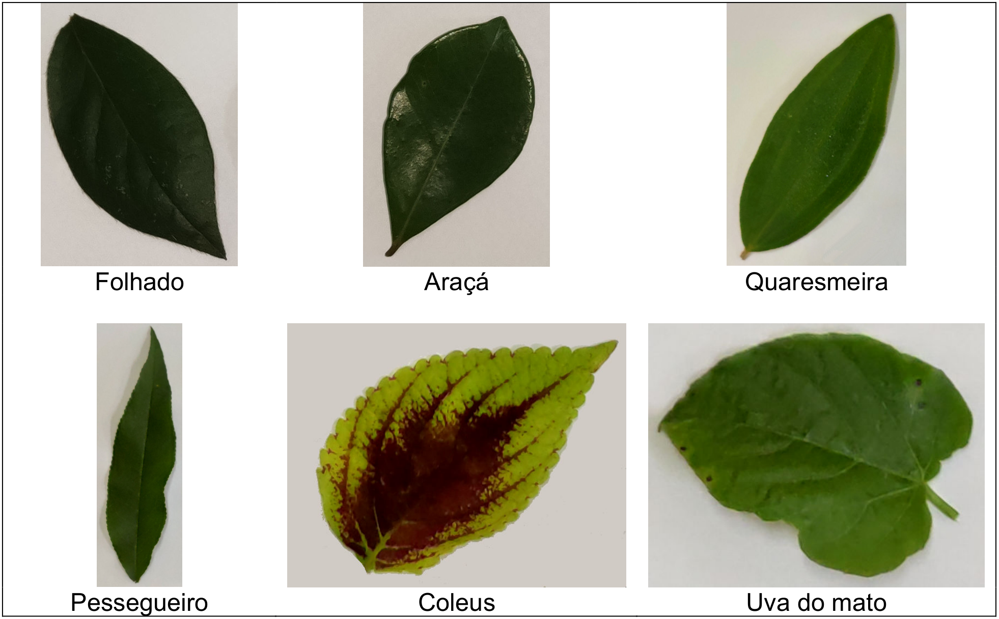

# UNIVERSIDADE ESTADUAL DO OESTE DO PARANÁ – UNIOESTE
## CAMPUS UNIVERSITÁRIO DE CASCAVEL
### CURSO DE CIÊNCIA DA COMPUTAÇÃO

**Disciplina:** Processamento de Imagens Digitais.  
**Profº:** Adair Santa Catarina.  

---

## TRABALHO DA DISCIPLINA DE PROCESSAMENTO DE IMAGENS DIGITAIS
### ANO 2026 – PARTE 01

Neste trabalho as imagens de entrada contêm folhas de 6 espécies vegetais fotografadas sobre um fundo “constante”. A figura 01 apresenta um exemplo de folha para cada uma das 6 espécies amostradas e seus nomes populares.

**Figura 1 – Um exemplar de folha para cada uma das espécies em estudo**

Na URL https://www.inf.unioeste.br/~adair/PID/Trabalhos/Imagens/ estão disponíveis 36 imagens para treinamento do sistema a ser desenvolvido.

Utilizando Morfologia Matemática para imagens binárias implemente um software que possibilite ao usuário selecionar, abrir e analisar uma imagem qualquer, como aquelas disponibilizadas para treinamento. A análise consistirá em assinalar na imagem os pixels de fronteira de cada folha, usando a cor vermelha. Além disso, deverá informar quantas folhas há na imagem e o número de pixels existentes na fronteira de cada folha. Lembre-se que as operações de identificação da fronteira (bordas) de cada folha da imagem deverão empregar algoritmos de Morfologia Matemática. Outras formas de extração de fronteira não serão consideradas.

Para não existir equívoco de interpretação, após desenhar a borda de uma folha, apresente o contador que representa o número de pixels desta borda. Use a tecla **`<Enter>`** para avançar para a análise ou desenho da borda da próxima folha.

Ou então crie um outro método mais eficiente e mais claro de interpretação dos resultados obtidos.

Por fim, dadas as 36 imagens de entrada, é possível identificar a espécie da planta usando apenas este descritor de fronteiras (número de pixels)?

Faça um relatório para apresentar suas conclusões, com as devidas justificativas. Ou seja, uma conclusão deve estar embasada em dados e na análise destes dados.

Para abrir as imagens podem ser usadas bibliotecas auxiliares, como a OpenCV ou QDBMP. Entretanto, nenhuma outra funcionalidade desta ou outra biblioteca poderá ser utilizada para obtenção dos resultados. Ou seja, todos os algoritmos de processamento de imagens devem ser desenvolvidos pelos autores.

Para percorrer os pixels de fronteira de uma folha, identificada por meio de operações morfológicas, empregue o algoritmo seguidor de fronteiras, descrito nas páginas 814 a 816 do livro:

> GONZALEZ, R. C.; WOODS, R. E. **Digital imagem processing**. 4. ed. New York: Pearson Education Limited, 2018.

**O programa deverá ser desenvolvido em linguagem C, C++ ou Rust.** O uso de outra linguagem de programação não será permitido.

Os autores deverão deixar explícito, em seus relatórios, uma **“Declaração de uso de IA”** citando quais IAs foram utilizadas e com qual finalidade, sendo vedado seu uso como geradora de código para a solução desenvolvida.

**Data de Entrega: 29/10/2026 (através do e-mail: adair.santacatarina@unioeste.br)**

**A data de entrega não será adiada, portanto iniciem os trabalhos o mais rapidamente possível.**

O trabalho poderá ser desenvolvido em grupo com **até 3 integrantes** e corresponderá a **50% da nota do Trabalho 2** da disciplina.

A apresentação dos trabalhos será realizada de acordo com agendamento, em datas posteriores à entrega.

Quaisquer dúvidas que restarem poderão e deverão ser esclarecidas através de consulta ao professor da disciplina.
