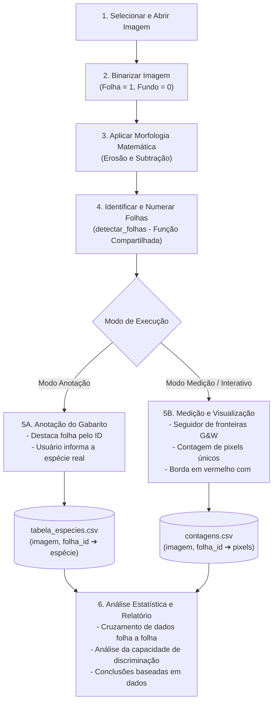

# Pipeline Macro do Projeto (PID 2026 - Morfologia Matemática)

Visão em alto nível do fluxo de processamento do projeto, destacando a etapa compartilhada de identificação e a bifurcação entre anotação e medição.

---

## 1. Diagrama Macro (Mermaid)

---

## 2. As Etapas em Alto Nível

1. **Selecionar e Abrir Imagem:** Carrega as fotos da pasta de entrada usando apenas as funções de leitura permitidas da OpenCV.
2. **Binarizar Imagem:** Converte a imagem colorida para binária, separando as folhas (1) do fundo (0).
3. **Aplicar Morfologia Matemática:** Executa operações manuais de limpeza (abertura e preenchimento de buracos) e extrai a fronteira morfológica ($A - (A \ominus B)$).
4. **Identificar e Numerar Folhas (`detectar_folhas`):** Varre a imagem e atribui identificadores determinísticos às folhas (Folha 1, Folha 2...). **Esta função é idêntica para os dois fluxos.**
5. **Bifurcação:**
   * **Fluxo 5A (Anotação do Gabarito):** Exibe a folha numerada para que o usuário informe a espécie real (com base na Figura 1 do enunciado), gerando a `tabela_especies.csv`.
   * **Fluxo 5B (Medição e Visualização):** Percorre a borda com o seguidor de fronteiras de Gonzalez & Woods, calcula o número de pixels únicos, exibe o contorno em vermelho folha a folha com `<Enter>` e salva as medições em `contagens.csv`.
6. **Análise Estatística e Relatório:** Cruza os pixels medidos com a espécie real de cada folha, analisa a separabilidade das classes e fundamenta a resposta do relatório.
